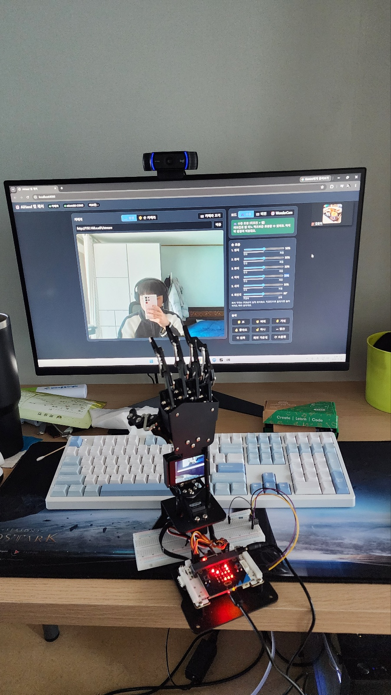

# AiHand 최종 프로젝트 구현 (김윤하 P6)

AiHand 최종 프로젝트를 구현했습니다. 코드는 이 폴더에 있고 (P5와 같습니다), 자세한 설치·사용법은 [P5 README](../P5/README.md)에 있습니다.



## 구현한 기능
- PC 웹캠 영상을 웹 화면에서 CCTV처럼 보기
- 웹 슬라이더·동작 버튼과 IR 리모컨으로 로봇 손 조종
- 웹 **✋ 따라 하기** 버튼이나 리모컨 **EQ**를 누르면 웹캠으로 손을 인식해서 따라 하기
- 움직이기 전에 0.5초 알림음

## 폴더 구조
```
aihand_final.jpg  # 구현 사진
microbit/
  robot_hub.ts    # 로봇 손 micro:bit: 리모컨, 서보, 알림음, 무선 받기 (MakeCode)
  pc_bridge.ts    # PC micro:bit: USB ↔ 무선 중계 (micro:bit 2개일 때)
web/
  web_server.py   # 웹캠 영상 + 조종 + 따라 하기 명령 전달
  index.html      # 웹 화면 (손 인식 포함)
  run_web.bat     # 더블클릭으로 실행
```

## 지금 연결 상태
- 아직 **micro:bit가 1개**라서 micro:bit 2개 무선 연결은 하지 못했습니다.
- 그래서 로봇 손 micro:bit를 PC에 바로 연결하여 **연결선이 2개**입니다.
- micro:bit를 하나 더 구하면 `microbit/pc_bridge.ts`를 넣어서 무선으로 바꿀 수 있습니다.
